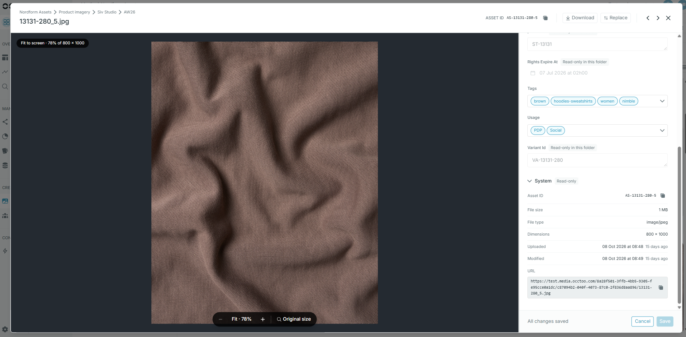

Each announcement has a dedicated page with full details and migration steps. Subscribe to the RSS feed to be notified of new announcements.

<Update label="November 2026" tags={["Studio","Sources","Media"]} description="Feature">
  ## Automatic entry expiration

  Choose how long source entries can remain unchanged before Occtoo deletes them. Configure the period in hours or days when you create or edit a source, see it in the source header, and track TTL deletions separately as **Expired** activity.

  Expiration is opt-in and runs nightly. Re-sending identical content does not reset the period. Deletion is permanent and includes associated media where applicable.

  [Read the full announcement →](/announcements/data-source-ttl)
</Update>

<Update label="October 2026" description="Feature" tags={["Studio", "Media"]}>
## Media Management

All your product images, videos and documents in one place in Studio, including files that arrive from other systems. Organise them in nested folders, tag them in fields you design, and update hundreds of files at once. Existing media, folders and tags are migrated automatically during Q4 2026.

[Read the full announcement →](/announcements/media-management)
</Update>

<Update label="October 2026" description="Deprecation" tags={["API", "Ingest"]}>
## Legacy Ingest API deprecation

The legacy string-based import (`POST /datasources/{dataSource}/import`) is deprecated and **will be removed on 1 May 2027**. Migrate to typed source ingest (`POST /v1/sources/{sourceId}`) with a tenant-level Application token.

[Read the full announcement →](/announcements/untyped-ingest-api-deprecation)
</Update>
