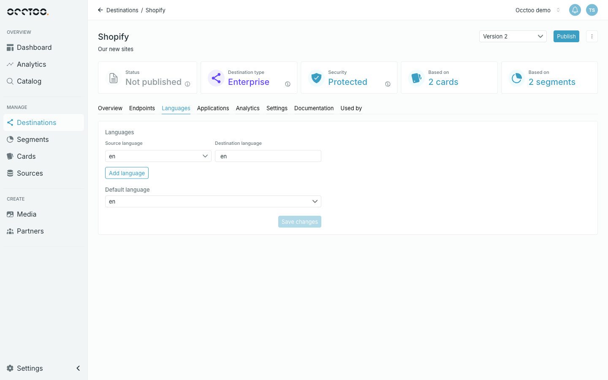

Localized properties are stored per language key. The **Languages** tab decides which of those keys this version serves, and what each is called on the API.

Each row is one mapping:

- **Source language** — a language key that exists in your onboarded data. The selector lists the keys Occtoo has seen.
- **Destination language** — the code callers use, for example in `&language=no`.

The two need not match. Data onboarded under `sv-SE` can be served as `sv`.

## Add or remove a language

Use **Add language** for a new row, and the bin icon to drop one. Then pick the **Default language** — the language served when a request does not ask for one — and click **Save changes**.

Keys and values must be 2–10 characters, may contain only letters, digits, `_` and `-`, and must each be unique within the version. The **Default language** selector only offers rows that are completely and validly filled in, and follows along if you delete the row it was pointing at.

On a published version, saved language changes go live straight away — there is nothing to publish. The tab is read-only only while a publish or update is running.

<Warning>
Removing a language or changing the **Default language** on a published version changes what callers get back at once. A request for a language the destination no longer carries returns the default language instead of an error.
</Warning>

Facet headers are entered per language, so adding a language means every faceted property needs a header for it — see [Endpoint content](/guides/studio/destinations/endpoint-content).
