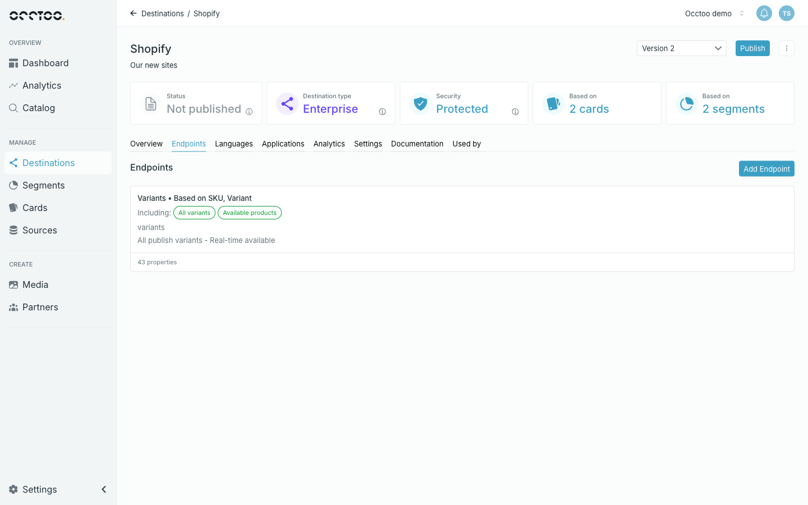
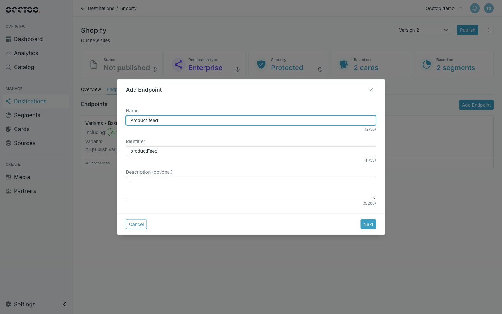
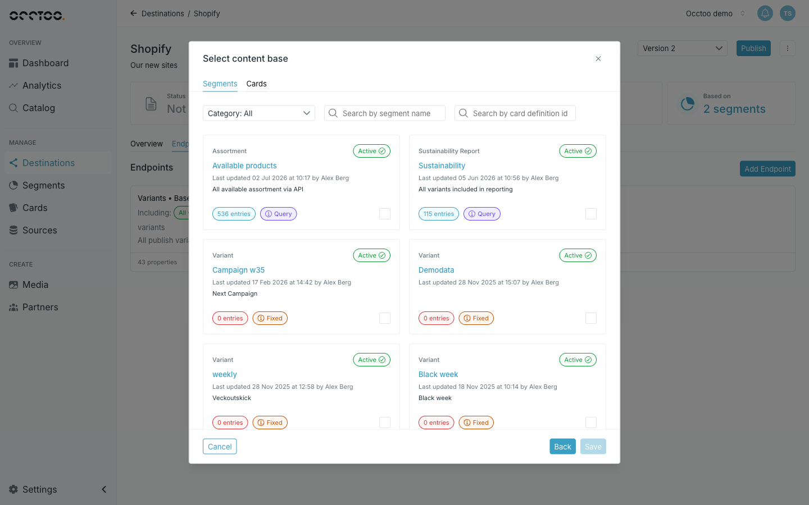

An endpoint is one callable path on a destination. A version can hold several, each exposing different data.

<Steps>
  <Step title="Open the Endpoints tab">

    Open the destination and select **Endpoints**, then click **Add Endpoint**.

    

    Each endpoint is listed with the card it is based on, the segments filtering it, its identifier, and how many properties it exposes.

  </Step>
  <Step title="Describe the endpoint">

    

    - **Name** — the display name.
    - **Identifier** — the URL segment, derived from the name as you type. At least 3 characters, alphanumeric and underscore only.
    - **Description** — optional.

    Click **Next**.

  </Step>
  <Step title="Select the content base">

    

    Two tabs decide what the endpoint serves:

    - **Segments** — the endpoint returns only the entries in that segment. Picking a segment also fixes the card it belongs to.
    - **Cards** — the endpoint returns every entry of that card.

    Filter by category or search by name, then tick the tile. Only one content base can be selected.

    <Warning>
    Switching between the **Segments** and **Cards** tab clears the selection you had made on the other tab.
    </Warning>

  </Step>
  <Step title="Save">

    Click **Save**. Studio creates the endpoint with every property of the card selected, and opens it so you can narrow that down.

  </Step>
</Steps>

You can add an endpoint to a published version too; it is callable as soon as it is saved. **Add Endpoint** is disabled only while a publish or update is running.

If the destination changed while you were adding the endpoint — someone else edited or published it — Studio explains why in an **Endpoint was not created** dialog. Click **Reload page** to load the latest version, then try again.

Next, choose which properties and relations the endpoint exposes — see [Endpoint content](/guides/studio/destinations/endpoint-content).
