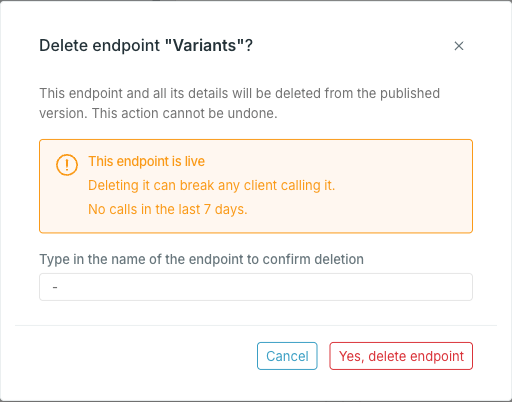

<Steps>
  <Step title="Open the endpoint">

    Open the destination, select **Endpoints**, and click the endpoint you want to remove.

  </Step>
  <Step title="Delete it">

    Click **Delete endpoint**, above the endpoint summary, and confirm.

  </Step>
</Steps>

<Warning>
Deletion cannot be undone. The endpoint's property selection, aliases, facets, segment filters and relations all go with it — recreating it means configuring all of that again.
</Warning>

## Delete from a published version

On a published version the endpoint is live, so the confirmation asks for more. It shows how many calls the endpoint received in the last 7 days — a non-zero count means a client is still using it — and you have to type the endpoint's name before **Yes, delete endpoint** goes through.

The path stops answering as soon as it is deleted. Move callers off it first.

## When it is blocked

**Delete endpoint** is disabled while a publish or update is running on the version.
