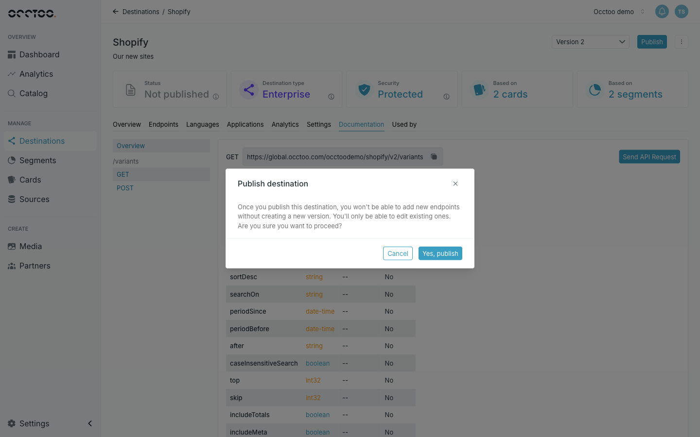

A version's APIs cannot be called until it is published. **Publish** sits in the destination header.

<Steps>
  <Step title="Click Publish">

    

  </Step>
  <Step title="Confirm">

    Click **Yes, publish**. The button becomes **Publishing** and the status card follows the run.

  </Step>
</Steps>

## When Publish is blocked

The button is disabled, with a tooltip, when:

| Reason | Fix |
| --- | --- |
| The version has no endpoints | Add at least one — see [Create an endpoint](/guides/studio/destinations/create-an-endpoint) |
| A card the version uses is not **Active** | Publish the card's pending changes first |
| A publish or update is already running | Wait for it to finish |
| You lack the publish permission | Ask an Administrator |

If you have unsaved endpoint changes, Studio asks before publishing and discards them if you continue — save first.

## Follow the run

While publishing, hovering the **Publishing** button shows the steps of the run, each with its status and timestamp, and the error message for any step that failed.

## Retry and restart

| Status | Button | What it does |
| --- | --- | --- |
| **Publish failed** | **Retry publish** | Runs the publish again |
| **Stopped** | **Restart** | Brings the version back up and reprocesses every endpoint |

A version stops when a card schema it depends on breaks. Restarting works once the card is valid again; if it is not, fix the card query and create a new version.

## Update a published version

Some changes can be published onto a live version without creating a new one — adding properties, segments and relations, and enabling facets. None of them change the shape of what consumers already read.

Saving one of those puts the version into **Pending changes** and brings **Publish** back. See [Pending changes](/guides/studio/destinations/pending-changes).

<Warning>
Publishing pending changes onto a live version shows an **Updates impact** warning per risky change. Read them before confirming — this API is already being called.
</Warning>

Endpoints and languages are not pending changes: adding or deleting one on a published version takes effect as soon as you save. See [Create an endpoint](/guides/studio/destinations/create-an-endpoint), [Delete an endpoint](/guides/studio/destinations/delete-an-endpoint) and [Manage languages](/guides/studio/destinations/add-languages).

Anything that would break the existing contract — removing a property or renaming an alias — needs [a new version](/guides/studio/destinations/create-a-version).
