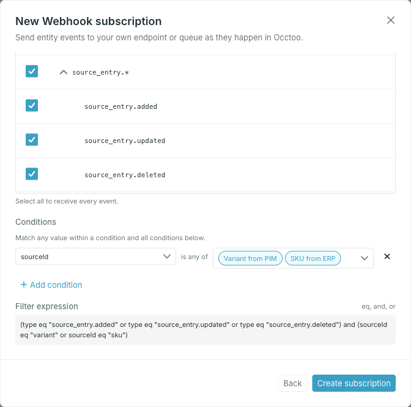

The filter decides which events reach the subscription. It has two parts: the **event types** you want, and optional **conditions** that narrow those types to one source, card, segment, destination or user.



## Event types

The tree groups the available event types into families. Ticking a family row selects every type under it; expand the row to pick individual types. The header checkbox selects all of them, and the counter above the tree tracks how many types are selected.

At least one type is required — the dialog will not create or save a subscription without one.

<Info>
What each type means, and what its payload carries, is listed in the [Events API reference](/api-reference/events/overview#event-types).
</Info>

## Conditions

Click **Add condition**, choose a property, and select one or more values in its dropdown. Selected values appear as badges; select an option again to remove it. For `subject`, enter values directly and use **Add value** to add another. Values within a condition are combined with **or**; separate conditions are combined with **and**. The property list holds only the properties the selected event types actually carry:

| Event types | Properties you can filter on |
| --- | --- |
| All event types | `subject` |
| `source.*`, `source_entry.*` | `sourceId` |
| `card.updated` | `cardDefinitionId` |
| `card.segment_membership_changed` | `cardDefinitionId`, `segmentId` |
| `card_definition.*` | `cardDefinitionId` |
| `segment.*` | `segmentId`, `segmentDefinitionId`, `cardDefinitionId` |
| `destination.*` | `destinationId` |
| `destination_entry.*` | `destinationId`, `endpoint`, `endpointId`, `apiVersionId`, `apiVersion` |
| `endpoint.*` | `destinationId`, `endpointId`, `apiVersionId`, `apiVersion` |
| `user.*` | `userId` |

Select several families and the list offers the union of their properties.

Only `subject` uses text input. All other properties offer available values from your environment. The `endpoint` dropdown saves endpoint safe names, and `apiVersion` saves version numbers as strings. Repeated safe names or version numbers appear once. Identifier properties such as `endpointId` and `apiVersionId` save the selected resource IDs.

For destination-entry events, `endpoint` is the endpoint's safe name, such as `products`. Pair it with `destinationId` to match that safe name within one destination. Leave out `apiVersion` and `apiVersionId` if you want to match across API versions. Use `endpointId` for a specific endpoint identifier. The `endpoint.*` lifecycle events do not support safe-name filtering.

<Note>
  Newly filterable properties apply only to events processed after support is enabled. Older events are not backfilled, even when their payload already contains the property. See [Filter by endpoint safe name](/api-reference/events/overview#filter-by-endpoint-safe-name).
</Note>

To filter for one entry when creating or editing a subscription, click **Add condition**, choose `subject`, and enter the complete CloudEvent subject. Matching is exact and case-sensitive. Do not split the value on `/` or `.`; those characters can be part of an ID. Combine it with the event type and a parent condition such as `sourceId` or `cardDefinitionId` to distinguish entries that share an ID. See [Filter by subject](/api-reference/events/overview#filter-by-subject) for the value used by each event family.

<Note>
  Only events processed after subject filtering was enabled can match a subject condition. Older events are not backfilled, even when their payload already contains `subject`.
</Note>

<Warning>
Conditions are combined with **and**, so a condition applies to every selected event type. Adding `sourceId` while `user.*` types are also selected leaves the user events unable to match at all.
</Warning>

Changing a condition's property clears its values. Narrowing the event types can leave a condition on a property the remaining types do not carry. Studio then selects an allowed property and clears the values. Check the conditions and fill in their values again before saving.

## The compiled expression

**Filter expression** shows exactly what Studio sends, in a grammar limited to `eq`, `and` and `or`:

```text
(type eq "destination_entry.updated" or type eq "destination_entry.deleted") and destinationId eq "<destination-id>" and (endpoint eq "products" or endpoint eq "categories")
```

Types are joined with `or` and bracketed as a group once a condition is present. Multiple values for one property are also grouped with `or`, and conditions are joined with `and`. In this example, an update or deletion must belong to the selected destination and have either endpoint safe name.

Fill in every value before saving, or remove the empty value or condition. Incomplete values may be omitted from the expression preview, but they still block creation and saving.

When you edit an existing subscription whose filter cannot be represented by these conditions, Studio preserves it in the expression editor. Edit the expression directly, keeping a `type` constraint in every `or` branch.
