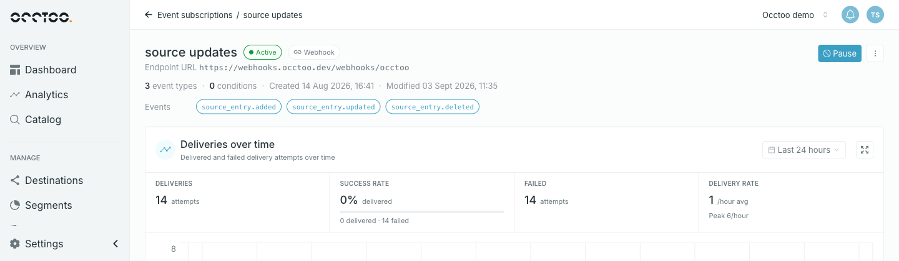
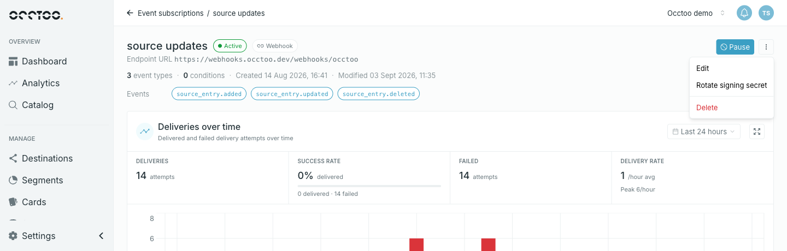

Opening a subscription shows what it delivers, where, and how that delivery has been going.

## The header

The name sits with two badges — the current **status** and the subscription **type** — above the delivery target. The label in front of the target changes with the type: **Endpoint URL** for a webhook, **Queue URL** for a Storage Queue, **Service Bus entity URI** for a Service Bus.

Below that: how many event types and conditions the filter holds, and when the subscription was created and last modified. The event-type number counts the types named in the filter, or all available types when the filter names none.

**Events** and **Conditions** then list the filter itself: one chip per event type, and one chip per condition. A condition with several values reads as its clauses joined by `or` — for example `endpoint eq "products" or endpoint eq "prices"`. A subscription with no conditions shows no **Conditions** row.

A subscription whose filter uses custom grouping shows **Custom filter** in place of the condition count, and the full filter expression in place of the condition chips. See [Event filter](/guides/studio/events/event-filter).

## The controls

**Pause** — or **Resume** on a paused subscription — sits at the top right, next to the kebab menu. Neither appears on a **Disabled** or **Deleted** subscription.

| Menu item | What it does |
| --- | --- |
| **Edit** | [Change the name, target or filter](/guides/studio/events/edit-a-subscription) |
| **Rotate signing secret** | [Issue a new webhook secret](/guides/studio/events/signing-secrets). Webhook subscriptions only |
| **Delete** | [Stop delivery for good](/guides/studio/events/pause-resume-and-delete) |

## The widgets

**Deliveries over time** charts final delivery outcomes against a time range. **Recent deliveries** shows one row per delivery with its current status and attempt count. Both are covered in [Monitor deliveries](/guides/studio/events/monitor-deliveries).
