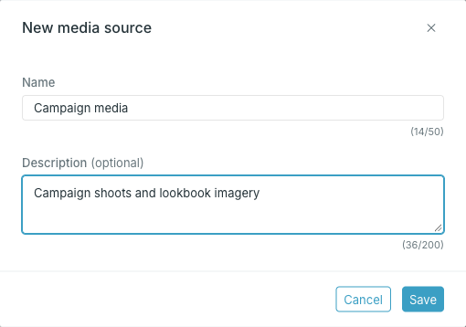
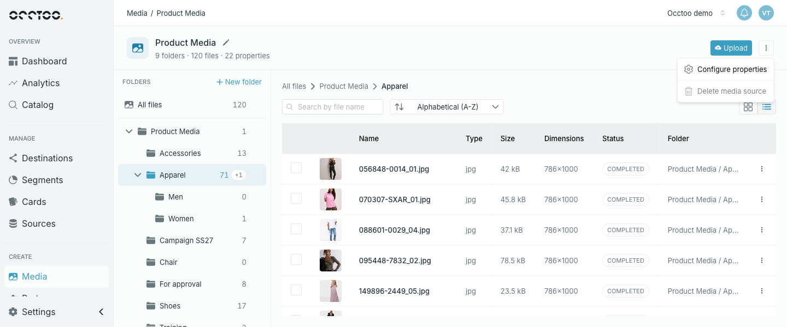

## Create a media source

<Info>
Media sources are created only from the **Media** page. **New data source** on the **Sources** page always creates a regular data source, which cannot hold folders or files.
</Info>

<Steps>
  <Step title="Press New media source">

    The button is in the top right corner of the **Media** page.

  </Step>
  <Step title="Enter a name and an optional description">

    

    The name must be unique among media sources. It can contain letters, numbers, spaces and standard symbols, and cannot start or end with a space.

  </Step>
  <Step title="Press Save">

    The new media source appears in the list. Open it to create folders and upload files.

  </Step>
</Steps>

<Info>
Studio derives the media source's identifier from the name when you create it. Renaming the media source later does not change the identifier.
</Info>

## Rename a media source

Open the media source and press the pencil next to its name. You can change the name and the description.

## Delete a media source

Open the media source, press the menu in the top right corner and choose **Delete media source**.

**Delete media source** is available only when the media source is empty and not in use — no files, and no card built on it. Delete its files first, and remove it from any card that uses it. It is also unavailable while the source is being purged.

<Warning>
Deletion cannot be undone. Studio returns you to the **Media** page.
</Warning>
