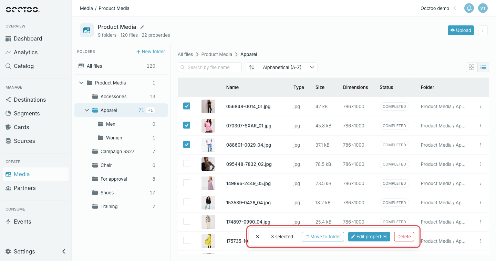
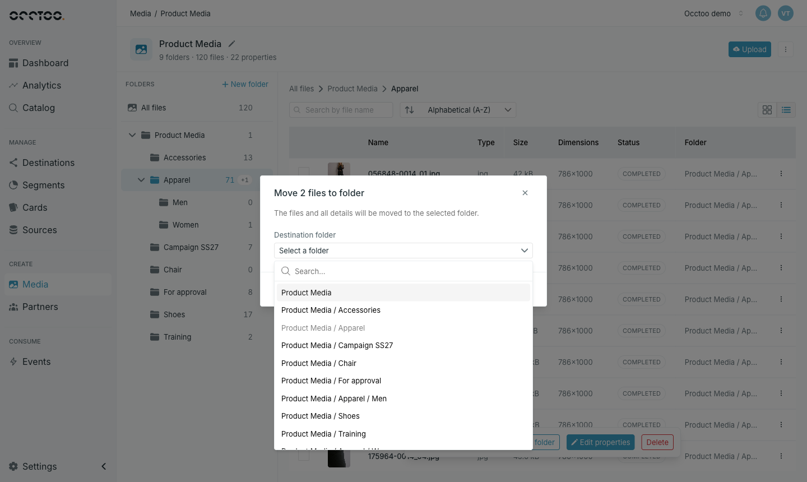
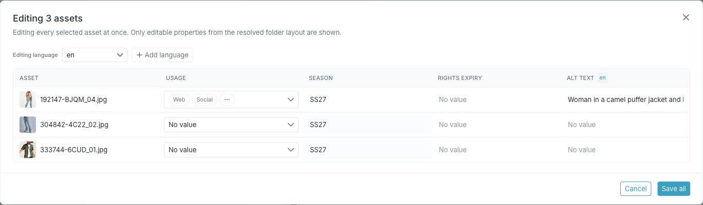

Tick the checkbox on each file you want — in list view at the start of the row, in grid view on the thumbnail. A bar appears at the bottom of the page with the number of selected files and the actions.

The selection is cleared when you switch folder, change the search, or complete an action. The **×** on the bar clears it by hand.

## Move to folder

**Move to folder** moves the selected files, with all their properties, to the folder you choose.

The list shows every folder by its path, and you can type to search it. The folder the files are already in is disabled when they all come from that folder.

## Edit properties

**Edit properties** opens a table with one row per selected file and one column per property you can edit.

<Steps>
  <Step title="Change the cells you need">

    Changed cells are highlighted. For localized properties, pick the language in **Editing language**, or press **Add language** to add one.

  </Step>
  <Step title="Press Save all">

    Only the cells you changed are saved.

  </Step>
</Steps>

<Info>
Only properties that are visible and editable in the [property layout](/guides/studio/media/property-layout) appear as columns. **Edit properties** is disabled when there are none.
</Info>

<Warning>
Closing the table with **Cancel** or the close button discards your changes without asking.
</Warning>

## Delete

**Delete** removes the selected files after you confirm.

<Warning>
Deleted files and all their property values are removed from Occtoo and cannot be restored.
</Warning>

<Info>
There is no download for a selection. To download a file, use **Download** in its menu or in the file view.
</Info>
