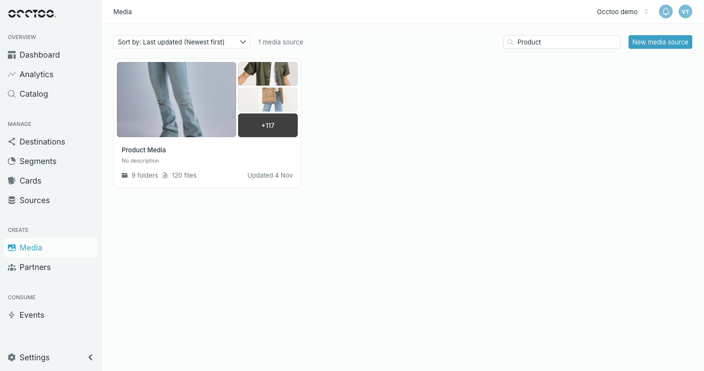

A **media source** holds files — images, videos, documents — organised in folders. Each file carries the properties you define for that media source, such as usage, season or alt text, and is delivered to your channels like any other data in Occtoo.

**Media** in the left navigation opens the list of media sources, with one card per source.

<Info>
Media Management is rolling out to all customers during Q4 2026. Until it reaches your environment, **Media** opens the previous version of the page.
</Info>

## What a media source card shows

- A preview of up to four files from the source. When there are more, the last tile shows how many are left.
- The **name**, which opens the media source, and the **description**, if it has one.
- The number of **folders** and **files**, and when the source was last updated.

A card shows a status badge while the media source is being purged.

## Sort and search

**Sort by** offers **Last updated** (newest or oldest first) and **Name** (A-Z or Z-A). The default is **Last updated (Newest first)**.

**Search by source name** filters the list as you type and matches anywhere in the name. The counter next to **Sort by** shows how many media sources match.

## Media sources in Sources

Media sources are data sources too, so they also appear on the **Sources** page next to your product sources, marked with a **Media** badge. Opening one there shows an **Open in Media** button that takes you to the media source.

## Who can do what

Anyone can browse media sources, folders and files. Creating and editing media sources, configuring properties, uploading, organising folders and editing, moving, replacing or deleting files need the **Contributor** role or higher — a **Reader** sees the same pages with those controls disabled. See [Users and roles](/guides/studio/settings/users-and-roles).
