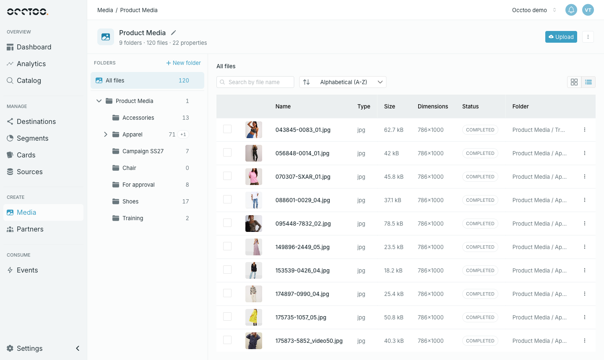
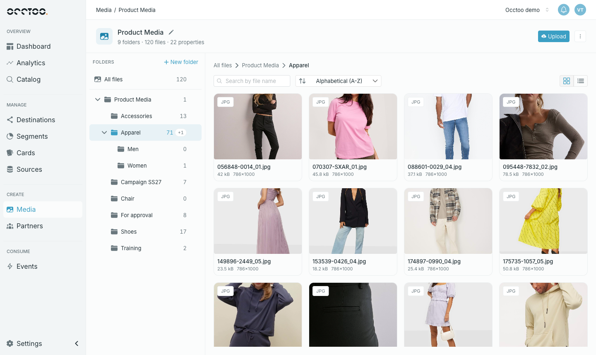
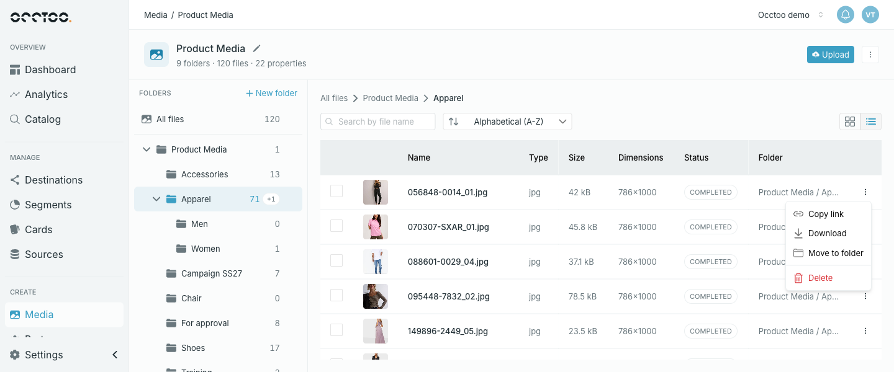
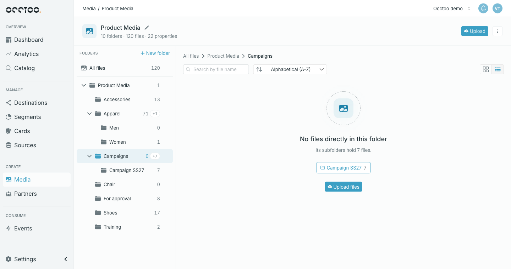

Opening a media source shows its folders on the left and its files on the right.

- **The header** shows the name, the number of folders, files and properties, the **Upload** button and a menu with **Configure properties** and **Delete media source**.
- **The folder tree** starts with **All files**, which shows every file in the media source. Below it is the top folder, named after the media source, with your folders inside it. See [Organise folders](/guides/studio/media/organize-folders).
- **The file list** shows the files of the selected folder, with breadcrumbs above it showing where you are.

## Folders and file counts

Each folder shows the number of files directly inside it. A grey **+N** next to it counts the files in its subfolders. Hover over the numbers for the exact totals.

Selecting a folder shows only the files directly inside it, not the files in its subfolders. To see everything, select **All files**.

## List and grid view

Switch between the two views with the buttons on the right of the toolbar. Studio remembers your choice.

- **List view** shows each file's name, type, size, dimensions, status and folder.
- **Grid view** shows a larger thumbnail with the name, size and dimensions.

More files load as you scroll.

## Sort

The sort menu orders files by upload date (**Newest first**, **Oldest first**), by name (**Alphabetical (A-Z)**, **Alphabetical (Z-A)**) or by size (**Largest first**, **Smallest first**). The default is **Newest first**.

## Search

**Search by file name** matches anywhere in the file name. It searches the selected folder only, without its subfolders — select **All files** to search the whole media source.

<Info>
Search covers file names only, not property values.
</Info>

## File actions

Click a file to open it. The menu at the end of each row, or on a thumbnail in grid view, offers **Copy link**, **Download**, **Move to folder** and **Delete**.

- **Copy link** copies the file's public URL.
- **Download** downloads that one file.
- **Move to folder** and **Delete** work as described in [Work with multiple files](/guides/studio/media/edit-multiple-files).

Files that are still processing after an upload show **Processing** and cannot be opened yet.

## Empty folders

An empty folder offers an **Upload files** button. If the folder has no files of its own but its subfolders do, Studio shows up to five of its subfolders, those holding the most files first, so you can jump to them. Any others are counted as **+N more** — open them from the folder tree.

