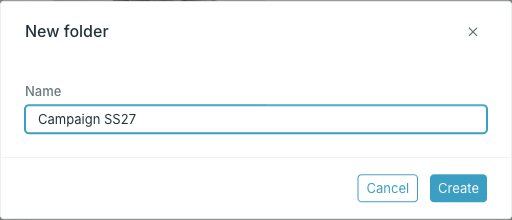
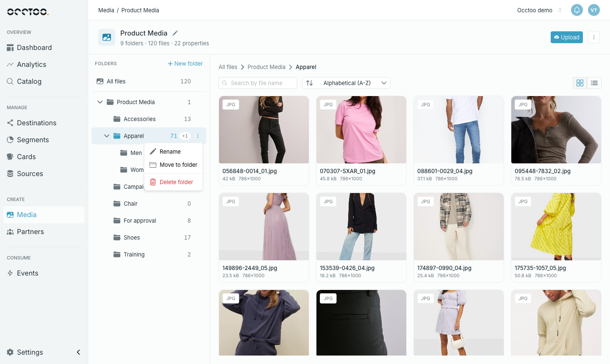
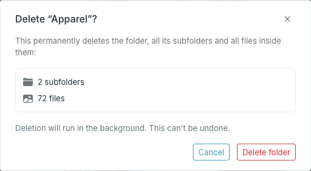

Folders can be nested, for example **Apparel / Women** or **Campaigns / SS27**. Every media source has a top folder named after it. Files can live directly in it, but it cannot be renamed, moved or deleted.

## Create a folder

<Steps>
  <Step title="Select the parent folder">

    Select the folder the new folder should go into. With **All files** selected, the new folder is created in the top folder.

  </Step>
  <Step title="Press New folder and enter a name">

    **New folder** is at the top of the folder tree.

    

    The name must be unique within the parent folder, ignoring case. Studio also derives an identifier from the name, and two folders in the same parent cannot share one. If they would, Studio names the folder that already uses it.

  </Step>
  <Step title="Press Create" />
</Steps>

## Rename, move or delete a folder

Hover over a folder and open its menu.

### Rename

**Rename** changes the folder's name. The identifier shown in the dialog stays the same.

### Move to folder

**Move to folder** moves the folder with its subfolders and all files in them. Pick the new parent from the list — the folder itself and its own subfolders are not offered.

<Info>
After a move, the folder path shown on each file updates shortly after.
</Info>

### Delete folder

**Delete folder** shows how many subfolders and files will be removed.

<Warning>
Deleting a folder permanently deletes all its subfolders and every file inside them, together with their properties. Deletion runs in the background and cannot be undone.
</Warning>
