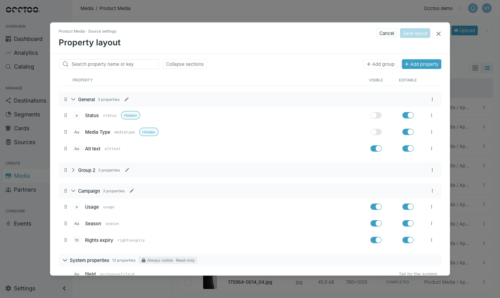
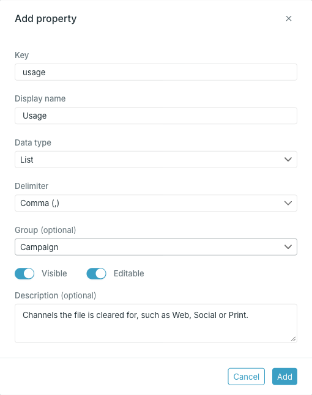

The **property layout** defines the fields on every file in a media source: which properties exist, which groups they appear in and in what order, and whether people can see and edit them. It applies to the whole media source, in every folder.

<Info>
Media source properties are source properties, so the Sources guides cover them in more detail: how delimiters split list values and what changing a data type does to existing values in [Add or edit a property](/guides/studio/sources/add-and-edit-a-property), and how properties become searchable, filterable and sortable in [Property capabilities](/guides/studio/sources/property-capabilities).
</Info>

Open the media source, press the menu in the top right corner and choose **Configure properties**.

## Sections

- **Your groups** come first, in the order you set.
- **General** holds properties that are not in any other group.
- **System properties** lists what Occtoo records for every file, such as the file name, size and URL. They are always visible and cannot be edited.

**Search property name or key** filters the list, and **Collapse sections** / **Expand sections** folds every group at once.

## Visible and Editable

- Turn **Visible** off to hide a property from the file view and from bulk editing. Hidden properties show a **Hidden** badge.
- Turn **Editable** off to show a property's value without letting anyone change it.

Drag the handle at the start of a row to reorder properties within a group, or drag a group's handle to reorder the groups. Dragging is unavailable while a search is active.

<Warning>
Visibility, editability and order are saved only when you press **Save layout**. **Cancel** discards them, and Studio asks before you leave with unsaved changes. Adding, editing or deleting properties and groups saves immediately and is not undone by **Cancel**.
</Warning>

## Add a property

<Steps>
  <Step title="Press Add property">

    

  </Step>
  <Step title="Fill in the fields">

    - **Key** — the property's identifier. It must start with a lowercase letter and can contain letters, numbers, `_` and `-`. It must be unique in the media source, ignoring case, and `id` is reserved. Studio saves the key in lowercase, and it cannot be changed later.
    - **Display name** — the label people see.
    - **Data type** — **Text**, **Localized text**, **List**, **Localized list**, **Boolean**, **Integer**, **Decimal** or **Timestamp**. List types also need a **Delimiter**, the character that separates values.
    - **Group** — where the property appears. **General** if left as is.
    - **Visible** and **Editable** — both on by default. Turning **Visible** off also turns **Editable** off.
    - **Description** — optional.

  </Step>
  <Step title="Press Add">

    The property is added at the end of its group.

  </Step>
</Steps>

## Edit or delete a property

Use the menu at the end of the property's row.

- **Edit property** changes the display name, data type, group and description. The data type is locked once segments, endpoints or relations rely on the property.
- **Delete property** removes the property and its values from every file in the media source. It is unavailable while a card uses the property.

<Warning>
Deleting a property cannot be undone. Deletion runs in the background.
</Warning>

While a property is being updated, its switches and **Edit property** stay disabled until the update completes.

## Groups

- **Add group** creates a group. Group names must be unique, ignoring case.
- The pencil next to a group's name, or **Rename group** in its menu, renames it.
- **Delete group** removes the group. Its properties stay on the media source and move to **General**.
