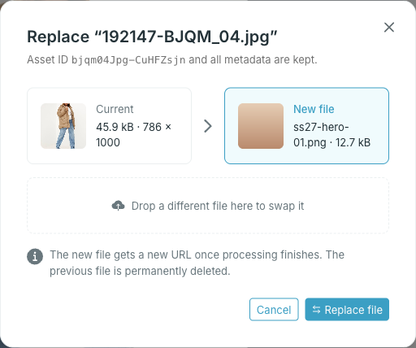

Replacing is for corrections — a retouched image, a re-exported PDF. The file keeps its **Asset ID**, folder and property values; only the content changes.

<Steps>
  <Step title="Open the file and press Replace" />
  <Step title="Drop the new file, or click the drop area to browse">

    

    The new file must be the same kind as the current one: an image for an image, a video for a video, a document for a document. The format can differ — a PNG can replace a JPG.

  </Step>
  <Step title="Press Replace file">

    Studio uploads the new file and waits for it to finish processing. The dialog stays open until then.

  </Step>
</Steps>

<Warning>
The new file gets a new URL once processing finishes, and the previous file is permanently deleted. Channels that use the old URL need the new one — the **Asset ID** stays the same.
</Warning>
