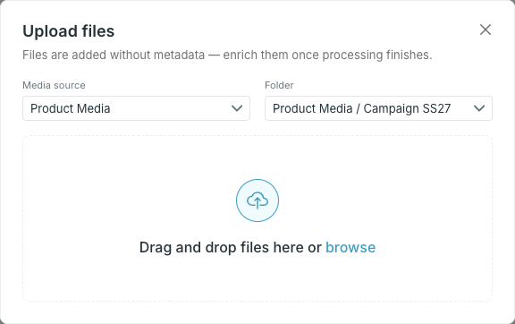
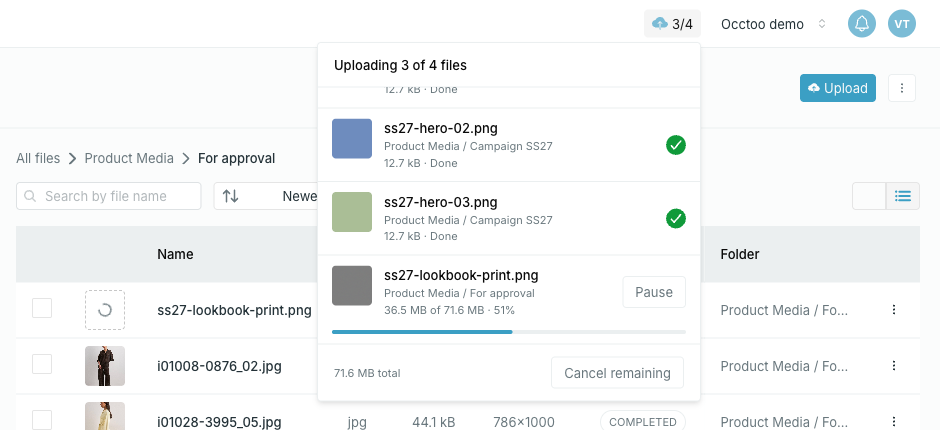
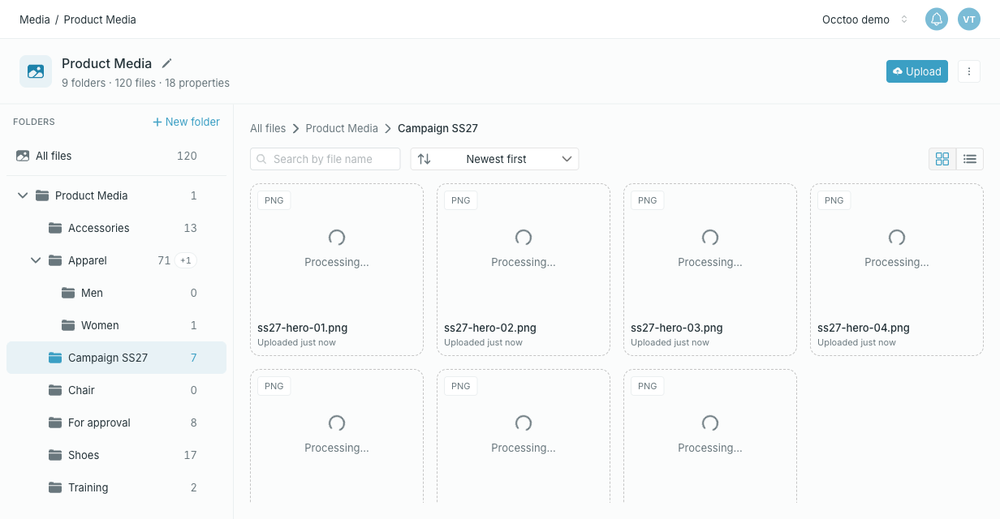

<Steps>
  <Step title="Open the folder and press Upload">

    **Upload** is in the header of the media source. Studio preselects the media source and the folder you are in. An empty folder also offers an **Upload files** button.

  </Step>
  <Step title="Check the media source and folder">

    Change **Media source** or **Folder** if the files belong somewhere else. Every **Upload** opens a new dialog on the media source and folder you are in, even while other files are still uploading.

  </Step>
  <Step title="Drag files onto the dialog, or press browse">

    The upload starts straight away and the dialog closes. The files carry on uploading in the background, and you can keep working anywhere in Studio — see [Track uploads while you work](#track-uploads-while-you-work).

    

  </Step>
</Steps>

<Warning>
Closing or reloading the browser tab stops every upload that has not finished, and the browser asks before it does. Those files do not complete — upload them again.
</Warning>

## Track uploads while you work

While files upload, the page header shows the upload icon with the number of files done out of the total. Press it to see every file in the upload and where it goes. The list opens on its own when you start an upload and nothing else is in it.

Up to 20 files upload at the same time; the rest wait as **Queued**. In the list:

- **Pause** stops an upload, and **Resume now** continues it.
- A failed upload is retried automatically. If it still fails, the row is marked as failed and **Resume now** tries again.
- The **×** on a queued row removes it, and **Cancel remaining** stops everything that has not finished.

A red dot on the icon means some files failed; a green dot means every file is uploaded. Once everything has finished, press **Clear** to empty the list, and the icon disappears.

## Upload to several places at once

You do not have to wait for an upload to finish. Press **Upload** in any media source or folder, add files, and they join the same list and upload alongside the others. Each file shows the media source and folder it goes to.

## After the upload

Files appear in the folder right away and show **Processing** while Occtoo generates the preview, reads the size and dimensions and publishes the link. They cannot be opened until processing completes. The list refreshes on its own.

Files are uploaded without property values. Open a file to fill them in, or select several and edit them together — see [View and edit a file](/guides/studio/media/view-and-edit-a-file) and [Work with multiple files](/guides/studio/media/edit-multiple-files).

<Info>
Uploading a file with the same name as an existing one does not overwrite it — each upload creates a new file. To swap the content of an existing file and keep its properties, use [Replace a file](/guides/studio/media/replace-a-file).
</Info>
