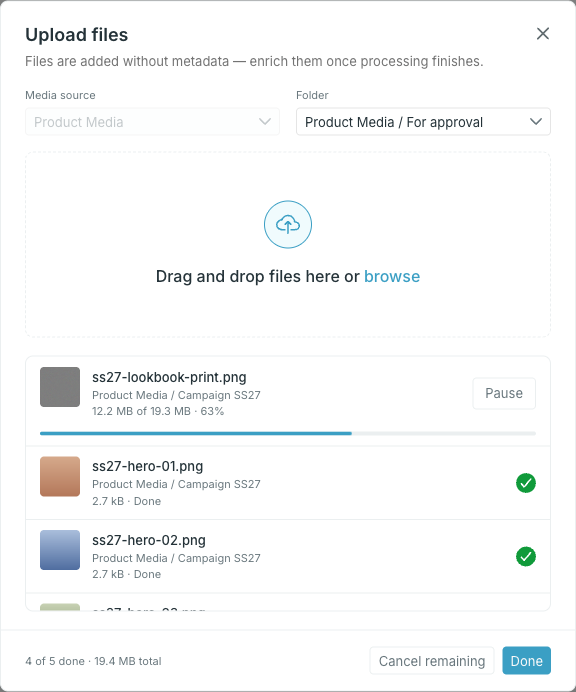
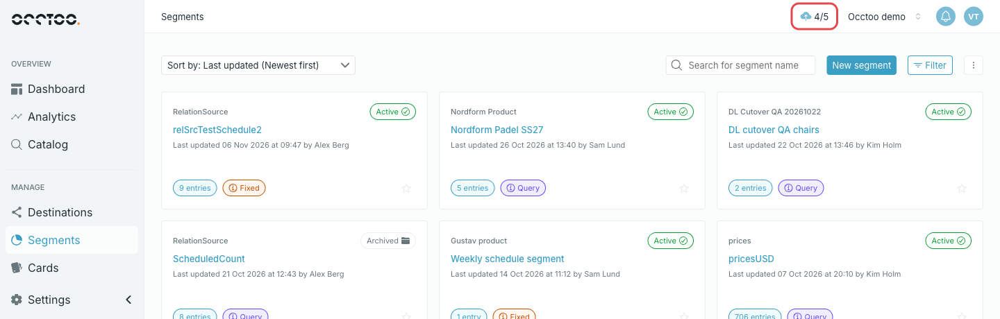
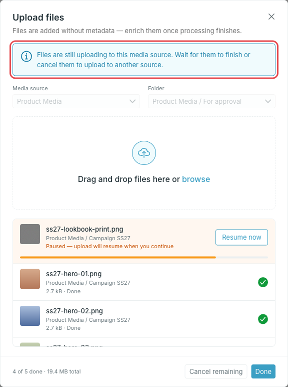
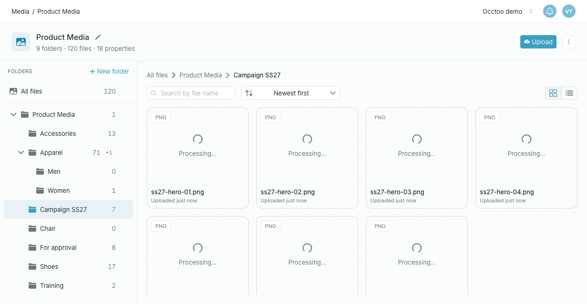

<Steps>
  <Step title="Open the folder and press Upload">

    **Upload** is in the header of the media source. Studio preselects the media source and the folder you are in. An empty folder also offers an **Upload files** button.

  </Step>
  <Step title="Check the media source and folder">

    Change **Media source** or **Folder** if the files belong somewhere else. The media source is locked once you add the first file. The folder is not: pick another one and add more files, and each file goes to the folder that was selected when you added it.

  </Step>
  <Step title="Drag files onto the dialog, or press browse">

    The upload starts straight away.

    

    Up to 20 files upload at the same time; the rest wait as **Queued**. Each row shows the folder the file goes to and its progress:

    - **Pause** stops an upload, and **Resume now** continues it.
    - A failed upload is retried automatically. If it still fails, the row is marked as failed and **Resume now** tries again.
    - The **×** on a queued row removes it, and **Cancel remaining** stops everything that has not finished.

  </Step>
  <Step title="Press Done">

    The dialog closes and the upload carries on in the background. You can keep working anywhere in Studio while it runs — see [Track uploads while you work](#track-uploads-while-you-work).

  </Step>
</Steps>

<Warning>
Closing or reloading the browser tab stops every upload that has not finished, and the browser asks before it does. Those files do not complete — upload them again.
</Warning>

## Track uploads while you work

While files upload, the page header shows the upload icon with the number of files done out of the total. Press it to open the dialog again with the same upload.

A red dot on the icon means some files failed; a green dot means every file is uploaded. Press **Done** in the dialog to clear a finished upload, and the icon disappears.

## Upload to another media source

One upload belongs to one media source. If you press **Upload** in another media source while files are still uploading, or while the last upload has failed files, the dialog opens on that upload with a notice, and you cannot add files until it is cleared:

- **Still uploading** — wait for it to finish and press **Done**, or press **Cancel remaining**.
- **Some files failed** — review them, then press **Done**.

An upload that finished without failures does not get in the way: the next **Upload** opens an empty dialog on the media source and folder you are in.

## After the upload

Files appear in the folder right away and show **Processing** while Occtoo generates the preview, reads the size and dimensions and publishes the link. They cannot be opened until processing completes. The list refreshes on its own.

Files are uploaded without property values. Open a file to fill them in, or select several and edit them together — see [View and edit a file](/guides/studio/media/view-and-edit-a-file) and [Work with multiple files](/guides/studio/media/edit-multiple-files).

<Info>
Uploading a file with the same name as an existing one does not overwrite it — each upload creates a new file. To swap the content of an existing file and keep its properties, use [Replace a file](/guides/studio/media/replace-a-file).
</Info>
