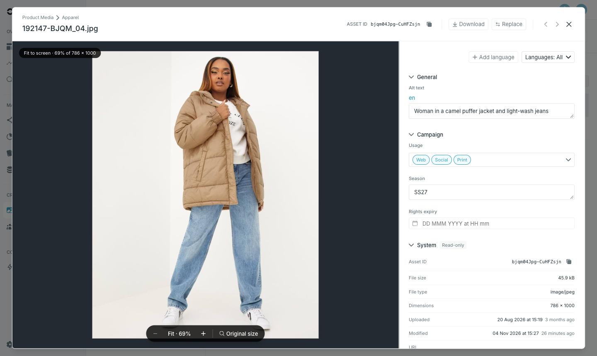

Click a file in the list to open it. The preview is on the left and the properties on the right.

## The header

- The folder the file is in, its name and its **Asset ID**, with a copy button.
- **Download** downloads the file.
- **Replace** swaps in a new version of the file — see [Replace a file](/guides/studio/media/replace-a-file).
- The arrows move to the previous and next file in the list, in the order and with the search you have applied.

## The preview

Images open fitted to the screen. Use the toolbar at the bottom to zoom in and out, or **Original size** to see the image at 100%. You can also zoom with the mouse wheel or a trackpad pinch, and drag to move around a zoomed image. **Esc** returns to the fitted view.

Videos play in the preview. Other files show their name and an icon.

## Edit properties

<Steps>
  <Step title="Fill in the fields">

    The fields are grouped as configured in the [property layout](/guides/studio/media/property-layout). Properties set to read-only show their value but cannot be changed, and hidden properties do not appear.

  </Step>
  <Step title="Press Save">

    The footer counts unsaved changes. Clearing a field removes its value.

  </Step>
</Steps>

<Warning>
Moving to another file or closing with **Cancel**, the close button or the arrows asks before discarding unsaved changes. Press **Save** first to keep them.
</Warning>

### Localized properties

A localized property has one value per language. Press **Add language** and enter a language code, such as `en` or `sv`, to add a field for it — the language is saved once you enter a value. The language filter next to it narrows which languages are shown; Studio remembers it per media source.

Language codes are 2–10 characters, using letters, numbers, `-` and `_`.

## The System section

**System** lists what Occtoo records about the file: **Asset ID**, **File size**, **File type**, **Dimensions**, **Uploaded**, **Modified** and **URL**. These values are read-only. Use the copy button next to **URL** to copy the file's public link.
