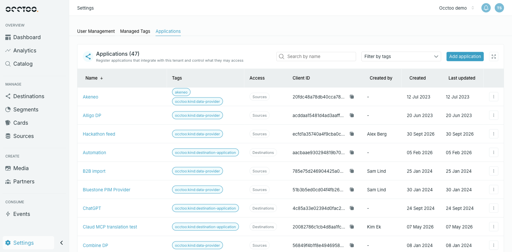
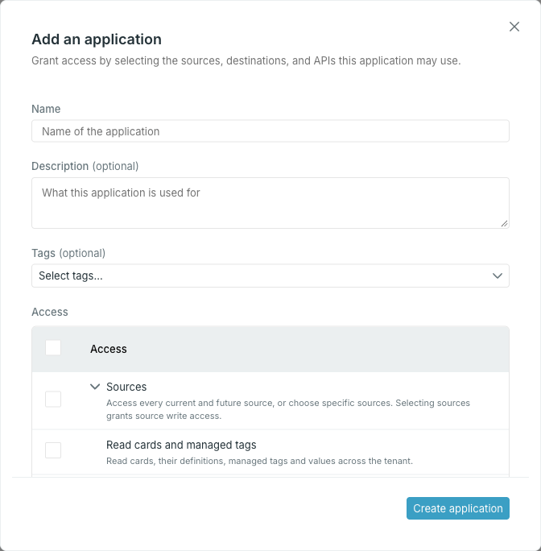

An application is the identity an integration uses to call Occtoo — a feed writing into sources, a storefront reading a destination, a script calling the tenant API. **Settings → Applications** lists every application in the tenant, and is where you create them and decide what each one may access.

## The list

Each row shows the application's **Name** (hover it for the description), its **Tags**, an **Access** summary, the **Client ID** with a copy control, who created it and when, and when it was last updated. **Access** names the top-level areas the application holds a grant in; hover it for the full list of sources, destinations and APIs.

Sort by **Name**, **Created by**, **Created** or **Last updated** from the column headers.

### Find an application

- **Search by name** narrows the list as you type.
- **Filter by tags** offers every tag in use. Pick several to see applications carrying **any** of them.

The two combine: a row has to match the search and at least one selected tag.

## Add an application

<Steps>
  <Step title="Open the form">

    Click **Add application**.

    

  </Step>
  <Step title="Describe it">

    - **Name** — required.
    - **Description** — optional; shown when you hover the name in the list.
    - **Tags** — optional labels for grouping applications, for example by team or integration partner. Pick an existing tag, or type a new one and choose **Create "…"**.

  </Step>
  <Step title="Grant access">

    **Access** lists what the application may do. Each row says what it grants.

    - **Sources** and **Destinations** expand into the tenant's sources, and its destinations and versions. Tick the top row to cover every current and future one, or expand it and tick only some — then sources or destinations added later are not included. Selecting sources lets the application write to them.
    - The other rows are capabilities across the tenant, such as reading or managing cards and managed tags, the Events API, and MCP tools.

    A partly granted row shows a mixed checkbox.

  </Step>
  <Step title="Create it and copy the secret">

    Click **Create application**. Studio shows the application's **Client ID** and **Client secret**.

    <Warning>
    The client secret is shown once and cannot be retrieved later. Copy it before closing the dialog — if you close without copying, Studio warns you once more, and closing again discards it.
    </Warning>

  </Step>
</Steps>

## Edit an application

Open the row's menu and choose **Edit application**. Change the name, description, tags or access, then click **Save changes**. Access changes apply to the existing credentials — there is no new secret.

If someone else saved the application after you opened it, Studio refuses the save. Reopen the application and apply your changes again.

## Get an access token

Choose **Get access token** from the row's menu to get a token for trying out the application's access, for example in a terminal or an API client.

When the application has access to a destination, **Target API audience** picks what the token is for: **Tenant API (all granted scopes)**, or one destination version. The token is generated as soon as the dialog opens and changes when you pick another audience. The dialog shows how long it stays valid.

<Info>
Studio never stores these tokens. In production, an integration should request its own tokens with its client ID and secret.
</Info>

## Delete an application

Choose **Delete application** from the row's menu, type the application's name and click **Yes, delete application**.

<Warning>
Deleting revokes everything granted to the application at once, and cannot be undone. Any integration still using its credentials stops working.
</Warning>

<Info>
Data providers and the applications registered on a destination's **Applications** tab are tenant applications too, and appear in this list tagged `occtoo:kind:data-provider` or `occtoo:kind:destination-application`. Filter by those tags to see one kind. See [Add a data provider](/guides/studio/sources/add-a-data-provider) and [Register an application](/guides/studio/destinations/register-an-application).
</Info>
