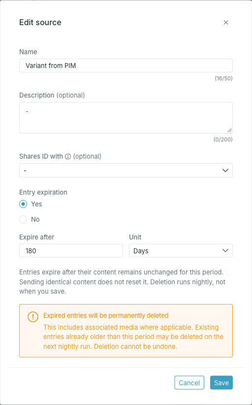

<Steps>
  <Step title="Open the source menu">

    Open the source and press the menu in the top right corner, then **Edit**.

  </Step>
  <Step title="Change the details">

    - **Name** — still has to be unique across sources.
    - **Description**.
    - **Shares ID with** — add or remove the sources this one shares entry IDs with.

  </Step>
  <Step title="Set or turn off entry expiration">

    To enable or change expiration, select **Yes** under **Entry expiration**. Enter a value in **Expire after** and choose **Hours** or **Days**. The period must be between 24 hours and 36,500 days and add up to a whole number of hours. To turn expiration off, select **No**.

    

    <Warning>
      Enabling expiration or shortening the period can make existing entries eligible for the next nightly cleanup. Occtoo counts from each entry’s last content change, even if you have imported identical content since then. Cleanup permanently deletes eligible entries, including associated media where applicable.
    </Warning>

  </Step>
  <Step title="Save">
    Press **Save**. The source header shows the saved **Entry expiration** period or **Off**.
  </Step>
</Steps>

<Warning>
The source identifier is not editable and is not shown in this dialog. Renaming a source changes only its display name — the identifier stays as it was derived when the source was created, so integrations and destinations are unaffected.
</Warning>
