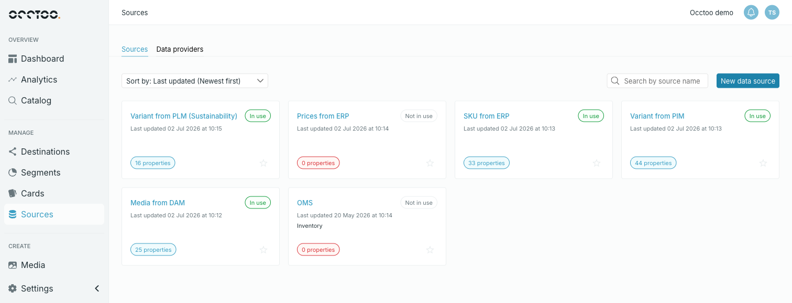
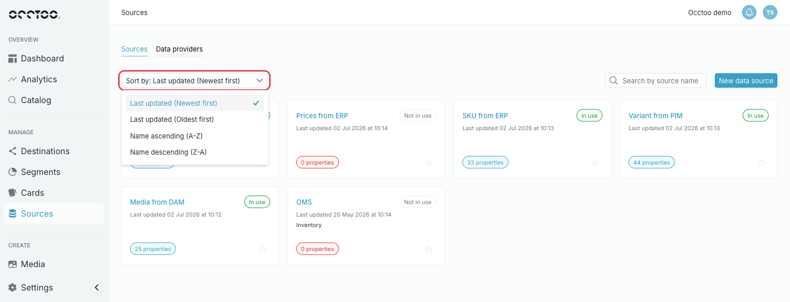

**Sources** in the left navigation opens the module on the **Sources** tab, with one card per source.

<Info>
  Media sources appear in this list too. Opening one shows **Open in Media**,
  which takes you to its folders and files — see [Find media
  sources](/guides/studio/media/find-media-sources).
</Info>

## What a source card shows

- The source **name**, which opens the source.
- **In use** or **Not in use** — whether any card is built on this source.
- **Last updated** with a date and time.
- The **description**, if the source has one.
- A property count badge. **0 properties** is called out, and means nothing has been onboarded and no properties have been defined yet.
- A star, which adds the source to your favourites.

## Sort

**Sort by** offers four orders. The default is **Last updated (Newest first)**.

- Last updated (Newest first)
- Last updated (Oldest first)
- Name ascending (A-Z)
- Name descending (Z-A)

## Search

**Search by source name** filters the list as you type. It matches anywhere in the name, not only the start.

<Info>
  The search covers source names only. To find a source by what is in it, open
  the source and search its entries — see [Browse and search
  entries](/guides/studio/sources/browse-entries).
</Info>
